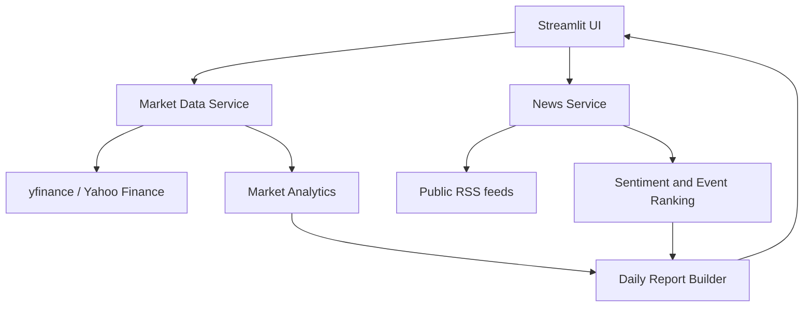

# AI-Powered Financial Market Intelligence System

A GitHub-ready research application that combines historical market data,
public financial headlines, explainable headline sentiment, market-event
triage, quantitative metrics and downloadable daily research notes.

> **Scope:** research and education only. This tool is not financial advice,
> does not execute trades and does not estimate causal price impact from news.

## Problem statement

Market research often requires analysts to switch between price histories,
news sources and spreadsheets. This project brings a lightweight watchlist
workflow into one reproducible Python application.

## Objectives and industry relevance

- Collect historical OHLCV data for a configurable ticker watchlist.
- Aggregate public RSS headlines and associate them with symbols where possible.
- Score headline polarity with VADER and label sentiment transparently.
- Compute return, annualized volatility, annualized return, Sharpe ratio,
  maximum drawdown and cross-asset return correlation.
- Rank potentially important headlines using a documented heuristic.
- Produce a timestamped research note and CSV exports from a Streamlit UI.

These capabilities are relevant to financial data engineering, market
surveillance, investment research support and FinTech analytics.

## Features

- Interactive Streamlit dashboard with price charts, KPIs and correlation heatmap.
- Yahoo Finance history through `yfinance`.
- Public RSS feed ingestion with source, URL, publication time and summary.
- Lightweight VADER sentiment; no paid LLM or API key required.
- Heuristic market-event ranking with explicit caveats.
- Downloadable Markdown research report, market CSV and news CSV.
- Modular services, logging, defensive parsing and unit tests.

## Technology stack

Python 3.10+, Pandas, NumPy, yfinance, feedparser, VADER Sentiment,
Plotly, Streamlit, pytest and python-dotenv.

## Architecture



## Folder structure

```text
01_AI_Financial_Market_Intelligence/
├── app.py
├── requirements.txt
├── .env.example
├── README.md
├── LICENSE
├── CONTRIBUTING.md
├── src/market_intelligence/
│   ├── __init__.py
│   ├── config.py
│   ├── analytics/
│   │   ├── __init__.py
│   │   ├── metrics.py
│   │   └── events.py
│   ├── services/
│   │   ├── __init__.py
│   │   ├── market_data.py
│   │   ├── news.py
│   │   └── reporting.py
│   └── utils/
│       ├── __init__.py
│       └── logging_config.py
├── tests/
├── docs/
├── notebooks/
├── reports/
└── assets/
```

## Mathematical foundations

Let adjusted closing price be \(P_t\).

- Simple daily return: \(r_t = P_t/P_{t-1} - 1\).
- Total return: \(\prod_t(1+r_t)-1\).
- Annualized volatility (daily observations): \(\sigma_{\text{ann}} =
  \operatorname{std}(r_t)\sqrt{252}\).
- Annualized geometric return: \((P_T/P_0)^{252/n}-1\), where `n` is the
  number of observed return intervals.
- Sharpe ratio: \(\sqrt{252}\,\bar r/\sigma_r\). This implementation uses a
  zero risk-free-rate assumption; it is a simplified historical statistic.
- Drawdown: \(P_t/\max_{s\le t}P_s-1\); maximum drawdown is its minimum.
- Correlation: Pearson correlation of aligned daily returns.

The annualization factor 252 assumes approximately 252 trading sessions/year.
Weekly data is not used by default in the UI. If using weekly data, annualized
metrics should be adjusted to 52 periods.

## Data and API sources

- **Market history:** Yahoo Finance data accessed through the open-source
  `yfinance` library. Availability, terms, coverage and rate limits are
  controlled by the provider; this is not an official Yahoo API.
- **News:** Google News RSS search feeds (public RSS endpoints). Feeds can
  change, omit articles or return duplicates. Article links remain owned by
  their publishers.
- **Sentiment:** VADER lexicon-based sentiment. It is general-purpose and may
  misread financial context, sarcasm, company names or numeric guidance.

No paid API is mandatory. No API key is needed for the baseline application.

## Installation

Python 3.10 or newer is recommended.

### Windows PowerShell

```powershell
py -3.11 -m venv .venv
.venv\Scripts\Activate.ps1
python -m pip install --upgrade pip
pip install -r requirements.txt
Copy-Item .env.example .env
```

### macOS / Linux

```bash
python3 -m venv .venv
source .venv/bin/activate
python -m pip install --upgrade pip
cp .env.example .env
```

## Run the dashboard

From the project root:

```bash
streamlit run app.py
```

Enter ticker symbols separated by commas, select a historical period, and
press **Refresh research**. Internet access is required for live collection.
If a provider is unavailable, the app displays an error or an empty-news
message rather than inventing data.

## Testing

```bash
pytest -q
```

Tests cover return/risk metrics, drawdown, event ranking and defensive
handling of empty news. The test suite does not require a network connection.

## Screenshots

Add your own screenshots here after running the dashboard locally, for example
`assets/dashboard-overview.png`. Screenshots are intentionally not fabricated.

## Limitations

- Yahoo Finance and RSS endpoints are third-party sources; availability and
  historical coverage are not guaranteed.
- News-to-ticker matching is based on query/feed context, not entity resolution.
- VADER is a baseline lexicon model, not a finance-trained transformer.
- Event ranking is a heuristic, not a prediction of returns or causal impact.
- No LLM summarization is enabled by default. Article summaries are whatever
  the RSS feed provides. This avoids mandatory paid services and fabricated
  summaries.
- No intraday execution, order management, portfolio advice or trading.
- Historical metrics do not predict future performance.

## Future improvements

- Add FinBERT with model-version pinning and evaluation on a labeled finance set.
- Add entity linking and deduplication across publishers.
- Add an optional LLM summarization adapter with user-supplied credentials.
- Persist snapshots in DuckDB/PostgreSQL and schedule daily jobs.
- Add event studies with benchmark-adjusted abnormal returns and leakage-safe
  event windows.
- Add data-quality monitoring and provider fallback adapters.

## Resume-ready project description

**AI-Powered Financial Market Intelligence System** — Developed a modular
Python and Streamlit research platform integrating historical equity data and
public financial news; implemented VADER-based headline sentiment, heuristic
event triage, annualized return/volatility, Sharpe ratio, maximum drawdown and
cross-asset correlation analytics, with downloadable research reports and
CSV exports. Built defensive data-ingestion services and offline unit tests.

Only include measured performance claims after independently validating them.

## Responsible use

For education and research only. Not investment advice. Verify market data and
news with primary sources before making financial decisions.
